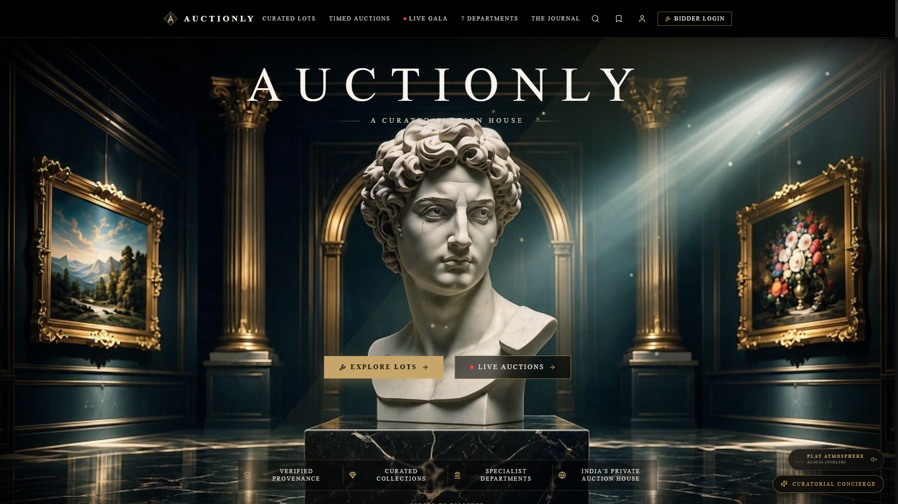
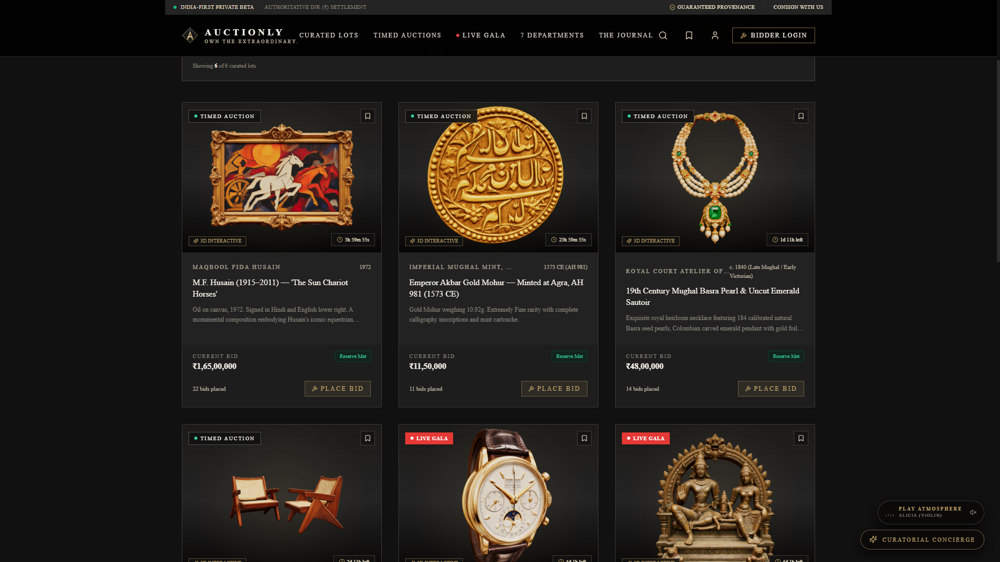
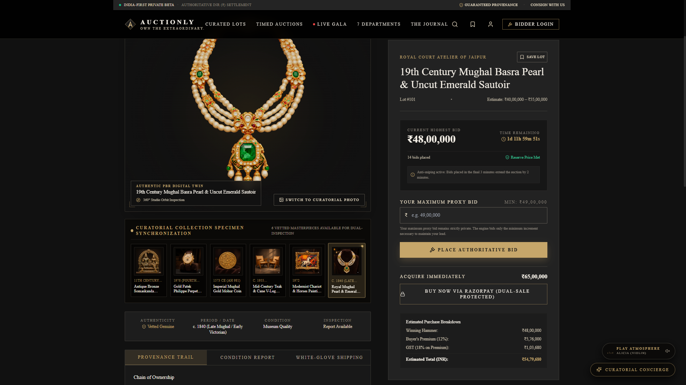
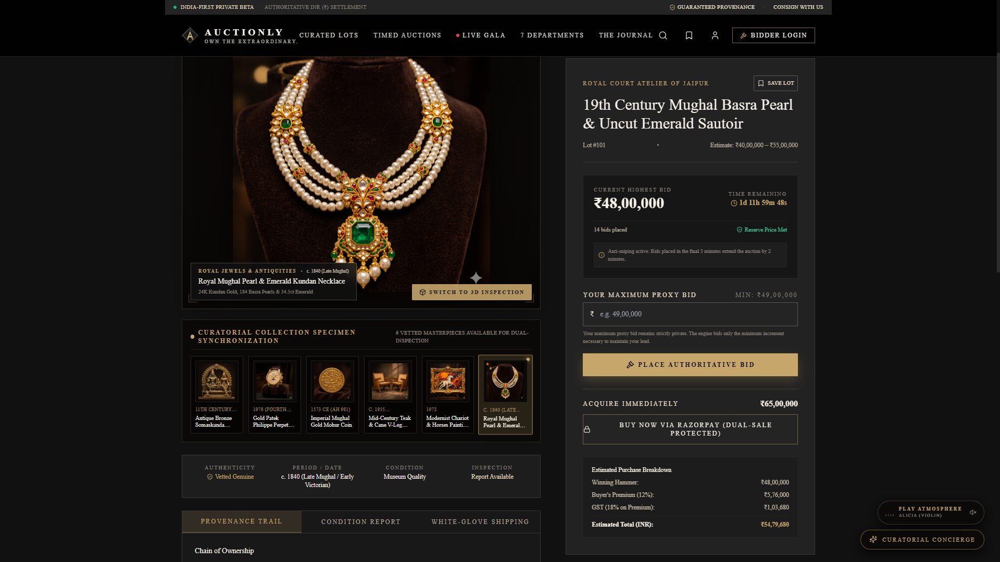
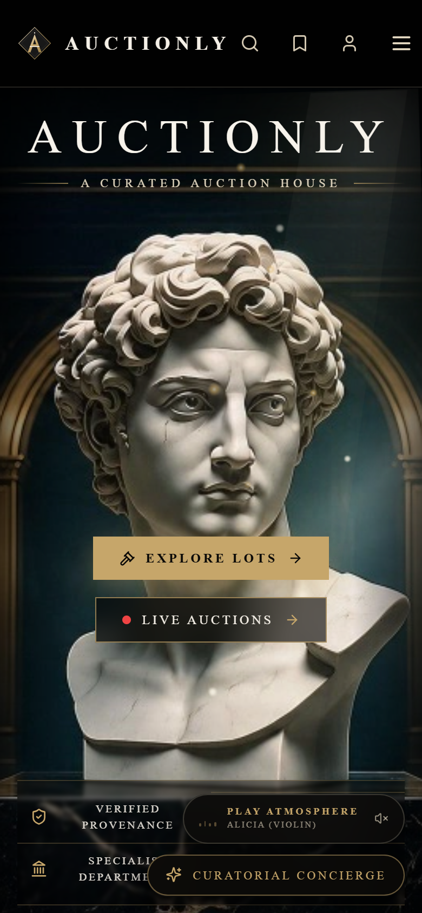

# AUCTIONLY — Own the Extraordinary.

A premium digital auction house bringing rare collectibles, fine art, historic antiquities and luxury objects into an immersive online auction experience.

**Live Website:** https://auctionly-three.vercel.app  
**GitHub Repository:** https://github.com/Peeks000/auctionly  
**Product Demonstration Video:** [docs/demo/auctionly-demo.mp4](docs/demo/auctionly-demo.mp4)

---

## 🎬 Product Demonstration

[](docs/demo/auctionly-demo.mp4)

> 🎥 **[Watch Full 1080p Walkthrough Video (MP4)](docs/demo/auctionly-demo.mp4)** — *A 40-second tour showcasing the cinematic museum hero with ambient idle atmosphere, scroll progression, auction catalogue, real-time WebGL 3D collectible stage, and synchronized curatorial photography.*

---

## 📸 Interface Showcase

### 01. Cinematic Museum Homepage
*Classical marble sculpture with dynamic sunlight sweep, floating atmospheric dust motes, and curated auction departments.*


### 02. Curated Auction Catalogue
*Live auction lot cards showcasing verified provenance, real-time INR proxy bidding, reserve status, and interactive 3D indicators.*


### 03. Interactive 3D Collectible Inspection
*Real-time WebGL 360° orbit inspection of digital twins with custom PBR lighting, material fidelity, and studio calibration.*


### 04. Curatorial Museum Photography
*High-resolution specimen photography synchronized with 3D models for dual forensic and aesthetic inspection.*


### 05. Responsive Mobile Experience
*Pixel-perfect mobile adaptation preserving editorial typography, 3D interaction, and touch-first bidding workflows.*

<p align="center">
  
</p>

---

## Project Highlights

- Cinematic luxury museum-inspired homepage.
- Interactive 3D collectible previews.
- Curatorial photography galleries.
- Seven specialist luxury departments.
- Timed auction and bidding interfaces.
- Live auction room demonstration.
- AI-powered auction concierge.
- Responsive desktop and mobile experience.

## Technology Stack

**Frontend:** Next.js 15, React, TypeScript, Tailwind CSS.

**3D & Animation:** Three.js, React Three Fiber, GSAP.

**Backend:** Supabase, PostgreSQL, Supabase Auth.

**Payments:** Razorpay integration (Test Mode).

**Deployment:** Vercel.

## Project Status

AUCTIONLY is presented as a portfolio and demonstration project.

Certain integrations require external credentials or commercial activation. Live video broadcasting is simulated, and payment processing remains in test mode.

Please consult `docs/FEATURE_STATUS.md` for the detailed implementation status and limitations.

## Getting Started

```bash
git clone https://github.com/Peeks000/auctionly.git
cd auctionly
npm install
copy .env.example .env.local
npm run dev
```

Open http://localhost:3000 to explore the project.

## Documentation

Refer to the `docs/` directory for the architecture, database design, security, testing, deployment and implementation documentation.
