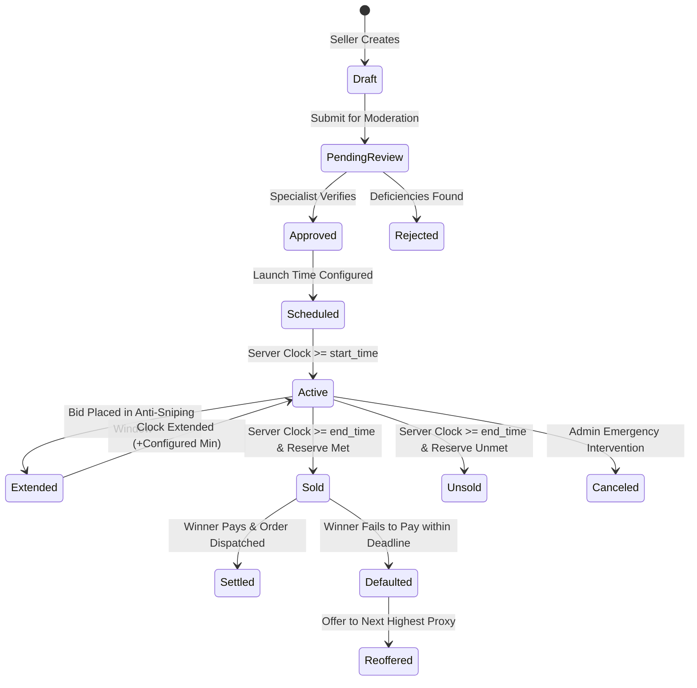
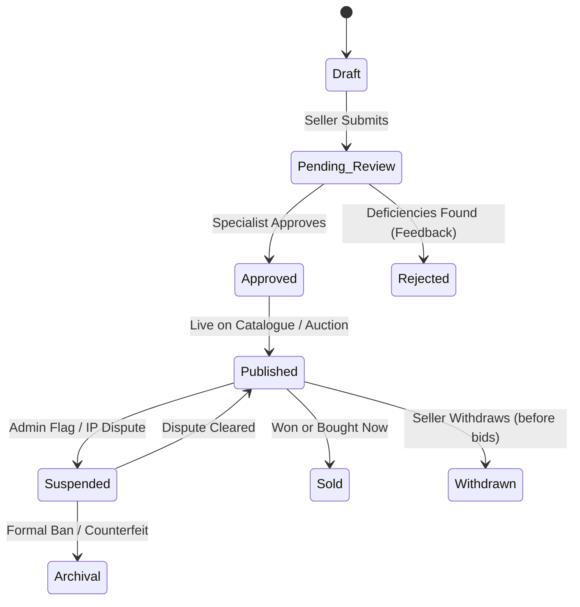
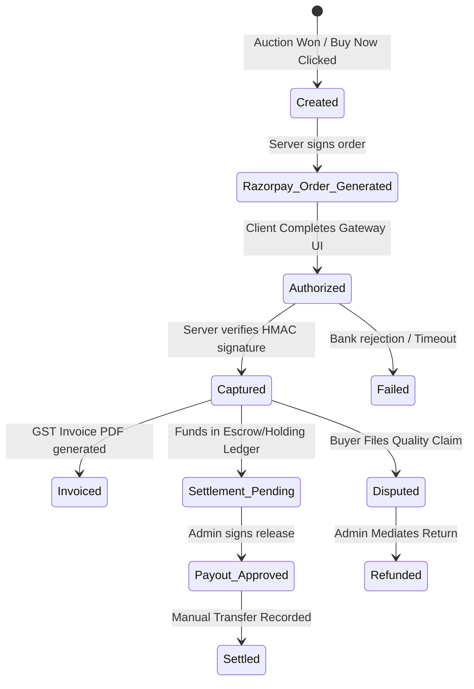

# AUCTIONLY — Technical Architecture & System Design

**Version:** 1.0.0-beta  
**Author:** Principal Software Architect  

---

## 1. System Topology Overview

```
                                    +------------------------------------------+
                                    |               Client Browser             |
                                    |  (Next.js App Router / React 19 Client)   |
                                    |   - Three.js / R3F Canvas (3D Viewer)    |
                                    |   - Realtime WebSocket Subscriber        |
                                    |   - Accessible UI / Tailwind CSS Tokens  |
                                    +--------------------+---------------------+
                                                         | HTTPS / WSS
                                                         v
                                    +--------------------+---------------------+
                                    |           Next.js 15 Server               |
                                    |        (Server Components & APIs)        |
                                    |   - Route Handlers & Server Actions      |
                                    |   - Auth Guard & RBAC Middleware         |
                                    |   - Razorpay Order & Webhook Signature   |
                                    |   - AI Concierge Grounding Engine        |
                                    +---------+--------------------+-----------+
                                              |                    |
                         Postgres RPC / Auth  |                    | HTTPS Webhooks
                                              v                    v
+---------------------------------------------+----+   +-----------+-----------+
|               Supabase PostgreSQL                 |   |   Razorpay Gateway    |
| - Row Level Security (RLS) on all tables         |   |      (Test Mode)      |
| - Concurrency-Safe RPC (`place_bid`, `buy_now`)  |   | - Payment Orders      |
| - Realtime CDC Broadcasts (Publication)          |   | - Signature Verif.    |
| - Storage Buckets (Media, glTF, Invoices)        |   +-----------------------+
+--------------------------------------------------+
```

---

## 2. Core State Machines

### 2.1 Auction State Machine


### 2.2 Listing Lifecycle State Machine


### 2.3 Payment & Settlement State Machine


---

## 3. High-Concurrency Server-Side Bidding Engine

### 3.1 Concurrency & Race Condition Elimination
Auction bidding is susceptible to classic TOCTOU (Time of Check to Time of Use) vulnerabilities when multiple bidders place bids within milliseconds.
AUCTIONLY strictly avoids client-side timestamps or naive ORM read-then-write updates. All bidding executes inside an atomic PostgreSQL function (`place_bid`) running under row-level locking:

```sql
-- Conceptual Atomic Bid Locking Function
CREATE OR REPLACE FUNCTION place_bid(
    p_auction_id UUID,
    p_bidder_id UUID,
    p_max_amount NUMERIC
) RETURNS JSONB AS $$
DECLARE
    v_auction RECORD;
    v_highest_bid RECORD;
    v_new_current_price NUMERIC;
    v_extension_window INTERVAL := INTERVAL '3 minutes';
    v_extension_duration INTERVAL := INTERVAL '2 minutes';
BEGIN
    -- 1. Acquire exclusive row lock on the auction record
    SELECT * INTO v_auction
    FROM auctions
    WHERE id = p_auction_id
    FOR UPDATE;

    -- 2. Validate authoritative server time & status
    IF v_auction.status != 'active' OR NOW() >= v_auction.end_time THEN
        RAISE EXCEPTION 'Auction is not active or has ended.';
    END IF;

    -- 3. Check bidder eligibility (cannot bid on own listing)
    IF v_auction.seller_id = p_bidder_id THEN
        RAISE EXCEPTION 'Sellers cannot bid on their own lots.';
    END IF;

    -- 4. Calculate minimum necessary bid
    IF p_max_amount < (v_auction.current_price + v_auction.min_increment) THEN
        RAISE EXCEPTION 'Bid must be at least current price plus minimum increment.';
    END IF;

    -- 5. Proxy Bidding Logic
    -- Query current highest proxy bidder
    SELECT * INTO v_highest_bid
    FROM bids
    WHERE auction_id = p_auction_id
    ORDER BY max_amount DESC, created_at ASC
    LIMIT 1;

    IF NOT FOUND THEN
        -- First bid: price set to starting_price
        v_new_current_price := v_auction.starting_price;
    ELSIF p_max_amount > v_highest_bid.max_amount THEN
        -- New bidder outbids current proxy leader
        v_new_current_price := LEAST(p_max_amount, v_highest_bid.max_amount + v_auction.min_increment);
    ELSE
        -- Current proxy leader retains lead; price advances
        v_new_current_price := LEAST(v_highest_bid.max_amount, p_max_amount + v_auction.min_increment);
        -- Update auction current price and exit
        UPDATE auctions SET current_price = v_new_current_price WHERE id = p_auction_id;
        RETURN jsonb_build_object('success', false, 'status', 'outbid_immediately');
    END IF;

    -- 6. Insert new bid record
    INSERT INTO bids (auction_id, bidder_id, current_price, max_amount, created_at)
    VALUES (p_auction_id, p_bidder_id, v_new_current_price, p_max_amount, NOW());

    -- 7. Anti-Sniping (Soft Close) Extension
    IF (v_auction.end_time - NOW()) <= v_extension_window THEN
        UPDATE auctions
        SET end_time = v_auction.end_time + v_extension_duration,
            current_price = v_new_current_price,
            bid_count = bid_count + 1
        WHERE id = p_auction_id;
    ELSE
        UPDATE auctions
        SET current_price = v_new_current_price,
            bid_count = bid_count + 1
        WHERE id = p_auction_id;
    END IF;

    RETURN jsonb_build_object('success', true, 'current_price', v_new_current_price);
END;
$$ LANGUAGE plpgsql SECURITY DEFINER;
```

### 3.2 Private Proxy Bidding Privacy Guarantee
- The `max_amount` field in the `bids` table is protected by PostgreSQL Row Level Security (RLS).
- **Rule:** A user can `SELECT max_amount` ONLY where `bidder_id = auth.uid()`.
- Public queries and Supabase Realtime broadcasts receive only the anonymized, public `current_price`, `bid_count`, and hashed bidder moniker (e.g., `Bidder #412`), never another bidder's maximum willingness to pay.

---

## 4. Dual-Sale Prevention Architecture (Auction vs Buy Now)

When a lot supports both Timed Auction and fixed-price Buy Now, race conditions could theoretically permit a user to Buy Now while an auction reaches its hammer.

### The Locking Contract:
1. Every listing has an `inventory_status` column: `available`, `reserved_in_checkout`, `sold_auction`, `sold_buynow`.
2. When Buy Now is initiated, an atomic transaction executes:
   ```sql
   UPDATE listings
   SET inventory_status = 'reserved_in_checkout',
       checkout_reserved_until = NOW() + INTERVAL '10 minutes'
   WHERE id = p_listing_id 
     AND inventory_status = 'available'
     AND (current_bid_count = 0 OR buy_now_allowed_with_bids = TRUE)
   RETURNING id;
   ```
3. If an auction receives a qualifying bid that meets the reserve, the `buy_now_price` is disabled automatically, securing the inventory exclusively for the auction bidders.

---

## 5. Three.js & React Three Fiber (R3F) Graphics Pipeline

1. **Progressive Enhancement:**
   - Detect WebGL2 support and client device capabilities.
   - If WebGL is unavailable or fails, gracefully render high-resolution 360-degree photography carousel or zoomable photographic gallery.
2. **Asset Validation & Optimization:**
   - Only `.glb` / `.gltf` binary formats permitted. Max upload size: 25MB.
   - DRACO compression enabled for efficient mobile geometry transmission.
   - PBR Materials with subdued environment map lighting (soft warm gold accents, `#C6A66A` specular highlights, `#111111` ambient darkness).
3. **Accessibility:**
   - 3D Viewers provide standard keyboard navigation (arrows for rotate, `+`/`-` for zoom).
   - `aria-label` and screen-reader descriptive alternatives provided for every 3D model.
   - Full reduced-motion preference (`prefers-reduced-motion: reduce`) stops automated camera pan/rotation.
