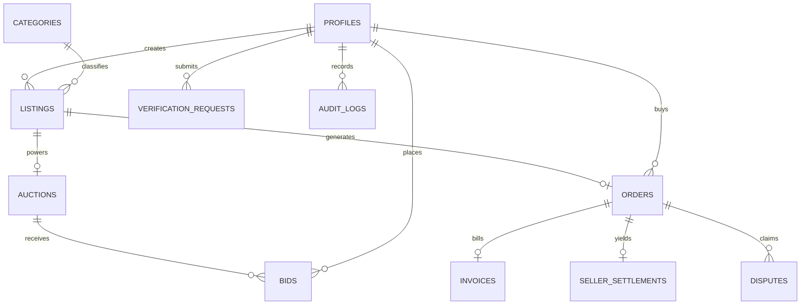

# AUCTIONLY — Database Schema & Data Integrity Design

**Database Engine:** PostgreSQL 15+ (Supabase)  
**Security Model:** Row Level Security (RLS) enforced across all tables  
**Monetary Representation:** Integer minor units (`BIGINT` in Indian Paisa, 1 INR = 100 Paisa) to avoid IEEE 754 floating point inaccuracies  
**Timestamps:** UTC `TIMESTAMPTZ` with timezone conversion in presentation  

---

## 1. Entity-Relationship Overview



---

## 2. Table Specifications

### 2.1 `profiles` (User Extensions & Roles)
```sql
CREATE TYPE user_role AS ENUM (
    'visitor',
    'buyer',
    'seller',
    'professional_auctioneer',
    'moderator',
    'verification_specialist',
    'customer_support',
    'finance_manager',
    'administrator',
    'super_admin'
);

CREATE TYPE verification_tier AS ENUM ('unverified', 'phone_verified', 'id_verified', 'enhanced_accredited');

CREATE TABLE profiles (
    id UUID PRIMARY KEY REFERENCES auth.users(id) ON DELETE CASCADE,
    email TEXT UNIQUE NOT NULL,
    full_name TEXT NOT NULL,
    phone TEXT,
    role user_role NOT NULL DEFAULT 'buyer',
    verification_status verification_tier NOT NULL DEFAULT 'unverified',
    avatar_url TEXT,
    bio TEXT,
    gstin TEXT,
    pan TEXT,
    billing_address JSONB DEFAULT '{}'::jsonb,
    shipping_address JSONB DEFAULT '{}'::jsonb,
    is_suspended BOOLEAN NOT NULL DEFAULT FALSE,
    created_at TIMESTAMPTZ NOT NULL DEFAULT NOW(),
    updated_at TIMESTAMPTZ NOT NULL DEFAULT NOW()
);
```

### 2.2 `categories` (Dynamic Luxury Taxonomy)
```sql
CREATE TABLE categories (
    id UUID PRIMARY KEY DEFAULT gen_random_uuid(),
    slug TEXT UNIQUE NOT NULL,
    name TEXT NOT NULL,
    description TEXT,
    buyer_premium_pct NUMERIC(4,2) NOT NULL DEFAULT 12.00,  -- 12.00%
    seller_commission_pct NUMERIC(4,2) NOT NULL DEFAULT 8.00, -- 8.00%
    display_order INT NOT NULL DEFAULT 0,
    is_active BOOLEAN NOT NULL DEFAULT TRUE,
    created_at TIMESTAMPTZ NOT NULL DEFAULT NOW()
);
```

### 2.3 `listings` (Catalog & Consignments)
```sql
CREATE TYPE listing_status AS ENUM (
    'draft', 
    'pending_review', 
    'approved', 
    'published', 
    'rejected', 
    'suspended', 
    'withdrawn', 
    'sold', 
    'archived'
);

CREATE TYPE inventory_state AS ENUM (
    'available', 
    'reserved_in_checkout', 
    'sold_auction', 
    'sold_buynow'
);

CREATE TYPE sale_format_type AS ENUM (
    'timed_auction', 
    'live_auction', 
    'buy_now', 
    'hybrid_auction_buynow'
);

CREATE TABLE listings (
    id UUID PRIMARY KEY DEFAULT gen_random_uuid(),
    seller_id UUID NOT NULL REFERENCES profiles(id),
    category_id UUID NOT NULL REFERENCES categories(id),
    title TEXT NOT NULL,
    slug TEXT UNIQUE NOT NULL,
    short_description TEXT NOT NULL,
    long_description TEXT NOT NULL,
    artist_or_maker TEXT,
    origin_period TEXT,
    dimensions JSONB DEFAULT '{}'::jsonb,   -- { height, width, depth, unit }
    materials TEXT[],
    condition_grade TEXT NOT NULL,          -- Mint, Excellent, Very Good, Restored
    condition_report TEXT,
    provenance_history TEXT,
    authenticity_status TEXT NOT NULL DEFAULT 'unverified', -- verified, unverified, under_review, disputed
    primary_image_url TEXT NOT NULL,
    gallery_image_urls TEXT[] NOT NULL DEFAULT '{}',
    model_3d_url TEXT,                      -- GLB / glTF file in Supabase Storage
    sale_format sale_format_type NOT NULL,
    starting_price BIGINT NOT NULL,          -- in Paisa (INR * 100)
    reserve_price BIGINT,                    -- Private reserve in Paisa
    buy_now_price BIGINT,                    -- in Paisa (optional for hybrid)
    estimate_low BIGINT,                     -- Presale low estimate in Paisa
    estimate_high BIGINT,                    -- Presale high estimate in Paisa
    status listing_status NOT NULL DEFAULT 'draft',
    inventory_status inventory_state NOT NULL DEFAULT 'available',
    rejection_reason TEXT,
    is_featured BOOLEAN NOT NULL DEFAULT FALSE,
    created_at TIMESTAMPTZ NOT NULL DEFAULT NOW(),
    updated_at TIMESTAMPTZ NOT NULL DEFAULT NOW()
);
```

### 2.4 `auctions` (Authoritative Bidding State)
```sql
CREATE TYPE auction_status AS ENUM (
    'scheduled', 
    'active', 
    'extended', 
    'closed_sold', 
    'closed_unsold', 
    'canceled'
);

CREATE TABLE auctions (
    id UUID PRIMARY KEY DEFAULT gen_random_uuid(),
    listing_id UUID UNIQUE NOT NULL REFERENCES listings(id) ON DELETE RESTRICT,
    status auction_status NOT NULL DEFAULT 'scheduled',
    starting_price BIGINT NOT NULL,
    reserve_price BIGINT,                    -- Private to seller and admin
    current_price BIGINT NOT NULL,           -- Current high bid in Paisa
    min_increment BIGINT NOT NULL,           -- Configurable increment in Paisa
    start_time TIMESTAMPTZ NOT NULL,
    end_time TIMESTAMPTZ NOT NULL,           -- Dynamic; extends with anti-sniping
    anti_snipe_trigger_minutes INT NOT NULL DEFAULT 3,
    anti_snipe_extension_minutes INT NOT NULL DEFAULT 2,
    extension_count INT NOT NULL DEFAULT 0,
    bid_count INT NOT NULL DEFAULT 0,
    winning_bidder_id UUID REFERENCES profiles(id),
    hammer_price BIGINT,
    reserve_met BOOLEAN NOT NULL DEFAULT FALSE,
    is_live BOOLEAN NOT NULL DEFAULT FALSE,  -- True for scheduled live galas
    created_at TIMESTAMPTZ NOT NULL DEFAULT NOW(),
    updated_at TIMESTAMPTZ NOT NULL DEFAULT NOW()
);
```

### 2.5 `bids` (Immutable Ledger with Private Proxy)
```sql
CREATE TABLE bids (
    id UUID PRIMARY KEY DEFAULT gen_random_uuid(),
    auction_id UUID NOT NULL REFERENCES auctions(id) ON DELETE RESTRICT,
    bidder_id UUID NOT NULL REFERENCES profiles(id),
    amount BIGINT NOT NULL,                  -- Displayed bid amount in Paisa
    max_amount BIGINT NOT NULL,              -- Secret proxy ceiling in Paisa
    is_proxy BOOLEAN NOT NULL DEFAULT FALSE,
    created_at TIMESTAMPTZ NOT NULL DEFAULT NOW()
);

-- Index for instant proxy evaluation
CREATE INDEX idx_bids_auction_max ON bids (auction_id, max_amount DESC, created_at ASC);
```

### 2.6 `orders` (Transactional Financial Records)
```sql
CREATE TYPE order_payment_status AS ENUM (
    'pending', 
    'authorized', 
    'captured', 
    'failed', 
    'refunded', 
    'disputed'
);

CREATE TABLE orders (
    id UUID PRIMARY KEY DEFAULT gen_random_uuid(),
    order_number TEXT UNIQUE NOT NULL,       -- e.g., AUC-2026-0001
    listing_id UUID NOT NULL REFERENCES listings(id),
    buyer_id UUID NOT NULL REFERENCES profiles(id),
    seller_id UUID NOT NULL REFERENCES profiles(id),
    hammer_or_sale_price BIGINT NOT NULL,    -- in Paisa
    buyer_premium BIGINT NOT NULL,           -- in Paisa
    tax_amount BIGINT NOT NULL,              -- GST in Paisa
    shipping_fee BIGINT NOT NULL DEFAULT 0,
    total_amount BIGINT NOT NULL,            -- Grand total in Paisa
    payment_status order_payment_status NOT NULL DEFAULT 'pending',
    razorpay_order_id TEXT UNIQUE,
    razorpay_payment_id TEXT UNIQUE,
    razorpay_signature TEXT,
    shipping_status TEXT NOT NULL DEFAULT 'unfulfilled', -- unfulfilled, dispatched, in_transit, delivered
    tracking_number TEXT,
    courier_partner TEXT,
    created_at TIMESTAMPTZ NOT NULL DEFAULT NOW(),
    updated_at TIMESTAMPTZ NOT NULL DEFAULT NOW()
);
```

### 2.7 `invoices` (GST Invoicing & Compliance)
```sql
CREATE TABLE invoices (
    id UUID PRIMARY KEY DEFAULT gen_random_uuid(),
    order_id UUID UNIQUE NOT NULL REFERENCES orders(id),
    invoice_number TEXT UNIQUE NOT NULL,     -- e.g., INV-IN-2026-0001
    invoice_date DATE NOT NULL DEFAULT CURRENT_DATE,
    seller_gstin TEXT,
    buyer_gstin TEXT,
    taxable_value BIGINT NOT NULL,           -- in Paisa
    cgst_amount BIGINT NOT NULL DEFAULT 0,
    sgst_amount BIGINT NOT NULL DEFAULT 0,
    igst_amount BIGINT NOT NULL DEFAULT 0,
    total_amount BIGINT NOT NULL,
    pdf_storage_path TEXT,
    created_at TIMESTAMPTZ NOT NULL DEFAULT NOW()
);
```

### 2.8 `seller_settlements` (Auditable Payout Ledger)
```sql
CREATE TYPE settlement_payout_status AS ENUM ('accrued', 'held_in_dispute', 'approved', 'processed', 'failed');

CREATE TABLE seller_settlements (
    id UUID PRIMARY KEY DEFAULT gen_random_uuid(),
    seller_id UUID NOT NULL REFERENCES profiles(id),
    order_id UUID UNIQUE NOT NULL REFERENCES orders(id),
    gross_amount BIGINT NOT NULL,            -- in Paisa
    commission_deducted BIGINT NOT NULL,     -- in Paisa
    tds_deducted BIGINT NOT NULL DEFAULT 0,  -- Indian Tax Deducted at Source (1% Section 194-O)
    net_payout BIGINT NOT NULL,              -- in Paisa
    payout_status settlement_payout_status NOT NULL DEFAULT 'accrued',
    bank_account_last4 TEXT,
    payout_reference TEXT,
    processed_at TIMESTAMPTZ,
    created_at TIMESTAMPTZ NOT NULL DEFAULT NOW()
);
```

---

## 3. Row Level Security (RLS) Policy Matrix

| Table | SELECT | INSERT | UPDATE | DELETE |
|---|---|---|---|---|
| `profiles` | Public (anonymized names) / Self full | Auth User (Self) | Self (except `role`) / Super Admin | Super Admin |
| `categories` | Public (active categories) | Admin / Super Admin | Admin / Super Admin | Super Admin |
| `listings` | Public (if `published`) / Seller (own) / Staff | Verified Seller | Seller (if `draft`/`rejected`) / Staff | Seller (if `draft`) / Super Admin |
| `auctions` | Public (except `reserve_price` if hidden) | System / Staff | System (RPC functions) / Staff | None |
| `bids` | Public (anonymized amount & public price) | Auth User via `place_bid` RPC | Never (immutable) | Never |
| `bids.max_amount` | **Bidder Only** (`bidder_id = auth.uid()`) | Via `place_bid` RPC | Never | Never |
| `orders` | Buyer (own) / Seller (own) / Finance / Admin | System / Checkout RPC | Finance Manager / Super Admin | None |
| `invoices` | Buyer (own) / Seller (own) / Finance / Admin | System Webhook | Admin | None |
| `seller_settlements`| Seller (own) / Finance / Super Admin | System | Finance Manager / Super Admin | None |
| `audit_logs` | Security Auditor / Super Admin | System triggers | Never (immutable) | Never |
